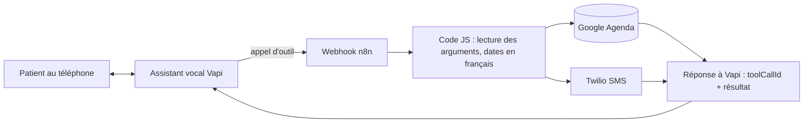

# Agent vocal de prise de rendez-vous (Vapi + n8n)

Réceptionniste téléphonique IA pour une clinique dentaire : le patient appelle, parle normalement, et l'agent vérifie les disponibilités, prend, modifie ou annule un rendez-vous, envoie la confirmation par SMS, ou passe la main à un humain.

La conversation est gérée par un assistant vocal Vapi. Chaque action concrète est un outil que l'assistant appelle par webhook, et chaque outil est un workflow n8n de ce dépôt. Le nom de la clinique et les numéros de téléphone ont été remplacés par des valeurs fictives (« Clinique Dentaire Exemple », 555-0100).

## Architecture

Chaque workflow lit `message.toolCalls[0]` dans le corps envoyé par Vapi, fait son travail, puis répond avec `{ results: [{ toolCallId, result }] }`. Le texte de `result` est rédigé pour être relu à voix haute par l'agent, et il lui dit explicitement quand le processus est terminé, pour éviter qu'il rappelle l'outil en boucle.

## Les six outils

| Workflow | Ce qu'il fait |
|---|---|
| `01-verifier-disponibilites` | Lit l'agenda sur 6 mois et calcule les plages libres d'au moins 60 minutes entre 8 h et 17 h, du lundi au vendredi. Tient compte du jour et du moment souhaités (« mardi », « le 26 mai », « en matinée ») et propose au plus 5 journées. |
| `02-vapi-creation-rdv` | Crée l'événement dans Google Agenda (nom, date de naissance, téléphone, raison) et envoie le SMS de confirmation au patient. |
| `03-modifier-rendez-vous` | Retrouve le rendez-vous par le numéro de téléphone, choisit le bon s'il y en a plusieurs (« celui de jeudi », « le 7 »), le supprime, crée le nouveau et confirme par SMS. |
| `04-annuler-rdv` | Même recherche, puis suppression et SMS d'annulation. Peut aussi départager par motif (extraction, nettoyage, examen, blanchiment). |
| `05-transferer-appel` | Le patient veut parler à quelqu'un : SMS immédiat à la clinique et rappel ajouté à l'agenda dans 30 minutes. |
| `06-demander-rappel-humain` | Enregistre une demande de rappel (raison, meilleur moment) dans l'agenda et prévient la clinique par SMS. |

## Ce qui a demandé le plus de travail

- **Les dates dites à l'oral.** Un patient ne dit pas « 2026-05-19 ». Le code convertit « mardi prochain », « lundi dans 2 semaines », « 19 mai », « le 1er juin », « demain » ou « aujourd'hui » en date ISO, et « 14h », « 9h30 » ou « 14:00 » en heure.
- **Les numéros de téléphone.** Ils arrivent sous toutes les formes ; ils sont normalisés au format +1XXXXXXXXXX avant l'envoi du SMS et la recherche dans l'agenda.
- **Trouver le bon rendez-vous à modifier ou annuler.** La recherche se fait par numéro de téléphone dans le texte des événements, puis par jour de la semaine, par date ou par motif. À défaut, c'est le rendez-vous le plus proche qui est retenu.
- **Garder un humain dans la boucle.** Le transfert et la demande de rappel ne laissent pas le patient sans suite : la clinique reçoit un SMS et l'agenda garde une trace.

## Installation

1. Importer les six fichiers du dossier `workflows/` dans n8n (menu « Import from File »).
2. Reconnecter les identifiants Google Agenda et Twilio : ils ne sont pas inclus dans les exports.
3. Remplacer l'agenda (`courriel@exemple.ca`), le numéro Twilio expéditeur et le numéro de la clinique par les vôtres.
4. Dans Vapi, déclarer six outils de type « function » qui pointent vers les URL de webhook (`verifier-disponibilites`, `creer-rdv`, `modifier-rendez-vous`, `annuler-rdv`, `transferer-appel`, `demander-rappel`), avec les arguments lus par chaque workflow (par exemple `nom`, `telephone`, `jour`, `heure`, `raison` pour la création).

## Limites connues

- La configuration de l'assistant Vapi (prompt système, voix, schéma des outils) n'est pas dans ce dépôt, seulement la partie n8n.
- Les webhooks n'exigent pas de jeton d'authentification. En production, il faudrait vérifier un en-tête secret envoyé par Vapi.
- Les dates sont calculées avec l'horloge du serveur n8n. Un serveur en UTC peut décaler une date de rendez-vous pris tard le soir ; il faut fixer le fuseau `America/Toronto` dans les réglages du workflow.
- Retrouver un rendez-vous par le téléphone suppose que le numéro est écrit tel quel dans l'événement, ce que font les workflows de création.
- Les renseignements des patients (nom, date de naissance, téléphone) sont stockés dans Google Agenda. Pour une clinique au Québec, cela doit être couvert par l'évaluation des facteurs relatifs à la vie privée exigée par la Loi 25.

## Technologies

n8n (webhooks, nœuds Code en JavaScript), Vapi, Google Agenda, Twilio.
